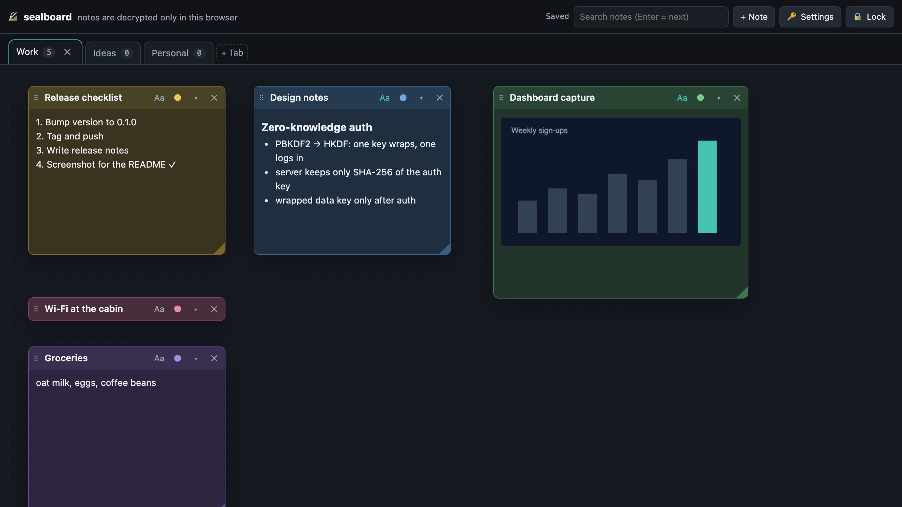
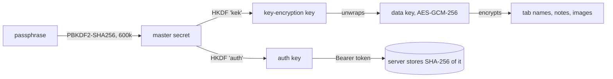

# sealboard

[](https://github.com/oh-namgyu/sealboard/actions/workflows/ci.yml)
[](LICENSE)
[](https://github.com/oh-namgyu/sealboard/releases)
[](pyproject.toml)

> **한글 요약** — 내 컴퓨터·서버에 직접 띄우는 **스티커 메모판**입니다. 탭별로 메모를 붙이고 끌어서 옮기고 크기를 조절하고 접을 수 있고, 일반 글·서식 글·캡처 이미지(붙여넣기·끌어놓기·화면 캡처)를 넣을 수 있습니다. 탭 이름·메모·이미지는 **브라우저 안에서만** 암호화·복호화되고 서버에는 암호문만 남아서, 서버 관리자나 데이터 파일을 가져간 사람도 내용을 읽을 수 없습니다. 로그인도 패스프레이즈에서 파생한 키로 하므로 서버는 패스프레이즈를 받지 않고, 패스프레이즈를 바꾸면 **새 데이터 키로 전부 다시 암호화**합니다. 원격 서버를 쓸 때는 `--remote` **로컬 클라이언트 모드**로 페이지 코드를 내 PC 에서 띄워, 서버가 탈취돼도 코드를 바꿔치기할 수 없게 합니다. 대신 **패스프레이즈를 잊으면 누구도 복구할 수 없습니다.** `pip install` 또는 Docker 로 실행합니다.

A self-hosted sticky-note board whose notes are encrypted in your browser — the server only ever stores ciphertext.



## Why

Sticky notes collect the things you would not put in a shared doc: half-formed plans, account hints,
screenshots of something you need later. Hosting them yourself solves "whose cloud is this on", but
the files on disk, the backups and anyone with shell access can still read them. sealboard keeps the
convenience of a web board and moves the trust boundary into the browser tab you are looking at.

## Features

- **Tabs** — rename (double-click), reorder (drag), delete; note counts per tab.
- **Sticky notes** — drag to move, drag the corner to resize, collapse to the title bar, six colours,
  bring-to-front. Double-click anywhere on the board to add a note.
- **Plain or rich text** per note — headings, lists, quotes, code, links, highlight.
- **Images** — paste a screenshot, drop a file, pick one, or capture a screen/window straight into a
  note. Images are downscaled and encrypted before they leave the page.
- **Search** across every tab, with hit counts per tab; Enter jumps to the next match.
- **Auto-lock** after inactivity (configurable) and a lock button; locking wipes keys and decrypted
  content from the page.
- **Safe with two windows open** — a stale save never overwrites a newer one; your edit is kept as a
  "conflict copy" next to it.
- Light and dark themes, keyboard friendly, works on phones.

## Quick start

**pip** (Python 3.9+):

```bash
pip install git+https://github.com/oh-namgyu/sealboard
sealboard                      # serves http://127.0.0.1:8080, data in ./sealboard-data
```

**Docker:**

```bash
git clone https://github.com/oh-namgyu/sealboard && cd sealboard
docker compose up -d
docker compose logs sealboard  # shows the one-time setup link
```

On the first start sealboard prints a one-time link such as
`http://127.0.0.1:8080/#setup=Xq3…`. Open it, choose a passphrase (10+ characters) and you are in.
The setup code stops working once the vault exists.

> ⚠️ Prefer the compose file (it publishes on `127.0.0.1` only). A bare `docker run -p 8080:8080`
> publishes on every interface.

## How the encryption works



- Everything runs in the browser with the WebCrypto API; the passphrase, the data key and plaintext
  never leave the page.
- Each tab name, note and image is sealed with AES-GCM using a fresh 96-bit IV and the item's id as
  additional data, so the server cannot swap ciphertexts between items.
- The server authenticates you by the auth key (it stores only its hash) and hands out the wrapped
  data key only after that. Someone who just reaches the server learns nothing but the KDF settings.
- Changing the passphrase creates a **new data key**: every note, tab name and image is re-encrypted in
  the browser and the server swaps them all in one atomic step, deleting images encrypted under the old
  key. Someone who knew the old passphrase cannot read anything you write afterwards.

What stays visible to the server: how many tabs and notes exist, their positions, sizes and colours,
which images belong to which note, and timestamps. A web page is only as trustworthy as the server that
sends its code — see [local client mode](#remote-server-local-code) for how to take the server out of that
picture. The full threat model is in [SECURITY.md](SECURITY.md).

## Using it from other devices

Browsers allow WebCrypto only on `https://` or `localhost`, so put a TLS reverse proxy in front.
With [Caddy](https://caddyserver.com/):

```caddyfile
notes.example.org {
    reverse_proxy 127.0.0.1:8080
}
```

```bash
SEALBOARD_ALLOWED_HOSTS=notes.example.org SEALBOARD_TRUSTED_PROXY=127.0.0.1 sealboard
```

`SEALBOARD_TRUSTED_PROXY` makes failed-login limits apply per real client instead of per proxy.

## Remote server, local code

If sealboard runs on another machine (a VPS, a home server), run a **local client** on the computer you
use it from:

```bash
sealboard --remote https://notes.example.org      # then open http://127.0.0.1:8080
```

The local client serves the app from your own installation and only forwards `/api/*` to the remote, so
the remote never delivers code to your browser — even a fully compromised remote server only ever sees
and returns ciphertext. Opening the remote's page directly (for example from a phone) still works, but
then you trust the code that server sends.

## Configuration

| Option | Env variable | Default | |
|---|---|---|---|
| `--host` | `SEALBOARD_HOST` | `127.0.0.1` | bind address (`0.0.0.0` in the Docker image) |
| `--port` | `SEALBOARD_PORT` | `8080` | |
| `--data` | `SEALBOARD_DATA` | `./sealboard-data` | `board.json` + `blobs/` — back this up; it is ciphertext |
| `--allowed-hosts` | `SEALBOARD_ALLOWED_HOSTS` | — | extra `Host` names (comma-separated) besides localhost |
| `--trusted-proxy` | `SEALBOARD_TRUSTED_PROXY` | — | your reverse proxy's address; trust its `X-Forwarded-*` |
| `--remote` | `SEALBOARD_REMOTE` | — | local client mode: serve the app here, keep data on this `https://` server |
| | `SEALBOARD_SETUP_CODE` | random | fixed setup code (16+ characters), e.g. for automation |

## API

All endpoints except the first two need `Authorization: Bearer <auth key>`; bodies carry only
ciphertext (`iv`, `ct`) and layout.

| Method | Path | |
|---|---|---|
| `GET` | `/api/vault` | KDF settings (or `{"exists": false}`) |
| `POST` | `/api/vault` | create the vault (needs the setup code) |
| `POST` | `/api/vault/rotate` | change passphrase: new KDF settings, new wrapped data key, every tab and note re-encrypted — swapped atomically |
| `GET` | `/api/board` | wrapped data key, tabs, notes |
| `PUT` `DELETE` | `/api/tabs/<id>` | create/rename · delete with its notes |
| `POST` | `/api/tabs/order` | reorder |
| `PUT` `PATCH` `DELETE` | `/api/notes/<id>` | save content (`baseRev`, 409 on conflict) · layout only · delete |
| `PUT` `GET` | `/api/blobs/<id>` | encrypted image (≤ 8 MB, immutable) |

## Development

```bash
pip install -e '.[e2e]'
python -m playwright install chromium
python -m pytest              # API, CLI and headless-browser end-to-end tests
```

See [CONTRIBUTING.md](CONTRIBUTING.md) for the ground rules (no plaintext to the server, no inline
styles under the CSP, small files).

## Prior art

- [Standard Notes](https://standardnotes.com/) and [Bitwarden](https://bitwarden.com/) — separating a
  login key from the encryption key, both derived from one passphrase, is their idea.
- [CryptPad](https://cryptpad.org/) — collaborative documents encrypted in the browser.
- [DOMPurify](https://github.com/cure53/DOMPurify) (bundled, Apache-2.0) sanitizes rich text.

sealboard is smaller than those: one person, one board, one process, files on disk.

## License

MIT — see [LICENSE](LICENSE). Security policy: [SECURITY.md](SECURITY.md).
Bundled DOMPurify is © Cure53 and contributors, Apache License 2.0 (see `sealboard/static/vendor/`).
